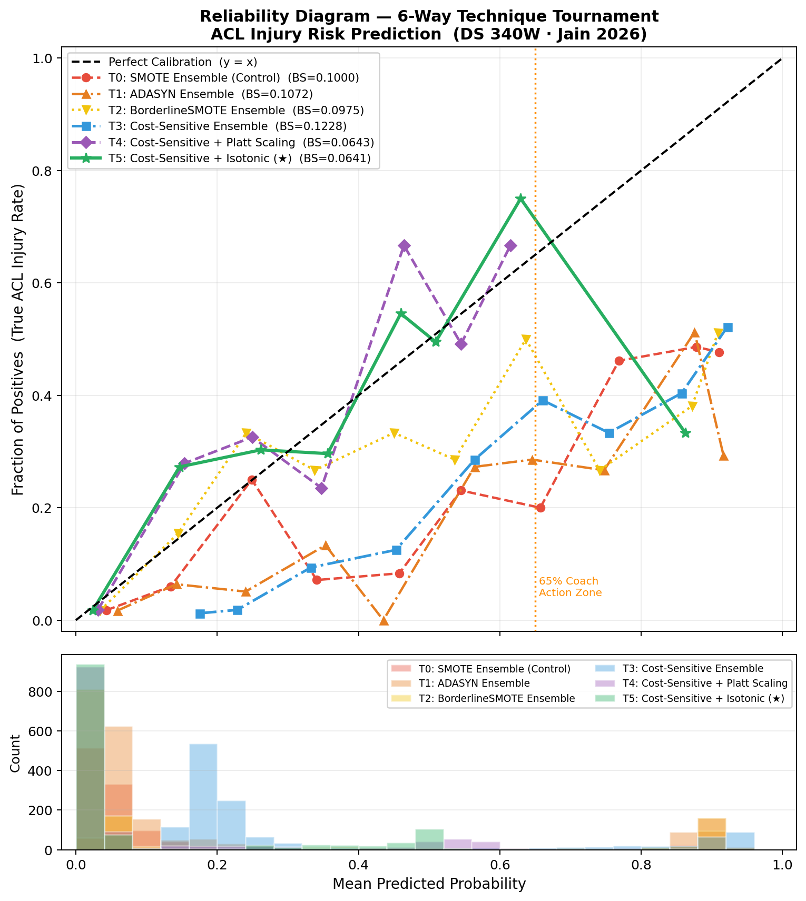
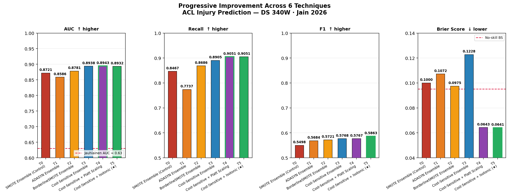

# Calibrating Injury-Risk Models: A Six-Way Comparison
### The "Cutting Signature" project

> DS340W Research Project — Penn State University, 2026  
> Moulik Jain

[](https://python.org)
[](https://scikit-learn.org)
[](https://xgboost.ai)

> **Read this first.** This course project compares ways of handling class imbalance and calibrating probabilities on three public Kaggle injury datasets. Those datasets appear to be simulated, and their labels are general injury flags, not diagnosed ACL injuries. The numbers below show how the methods behave on this data. They are not evidence about predicting real ACL injuries, and they can't be compared with clinical studies. See [What this can and can't show](#what-this-can-and-cant-show).

---

## Overview

The project began from a real problem. Lab screening for ACL risk with 3D motion capture is expensive and slow, so could a model built only on data that athletic trainers already collect (GPS load, fatigue scores, symmetry measures) give a usable risk estimate?

What it actually tests is narrower: on a combined dataset with a 10.6% injury rate, which way of handling the imbalance gives the best ranking and the most trustworthy probabilities? A model that says "65% risk" is only useful if about 65% of athletes given that score are injured, so calibration is the main thing measured.

---

## Key Results

Six-way comparison on a 20% stratified hold-out (N = 1,286 rows, about 137 injury events). Each model changes one component of the one before it. Figures are from `visualizations/acl_novelty_comparison_table.csv`.

| ID | Model | AUC | Recall | F1 | Brier ↓ | Avg precision |
|---|---|---|---|---|---|---|
| T0 | SMOTE ensemble (control) | 0.872 | 0.847 | 0.550 | 0.100 | 0.447 |
| T1 | ADASYN ensemble | 0.859 | 0.774 | 0.568 | 0.107 | 0.393 |
| T2 | BorderlineSMOTE ensemble | 0.878 | 0.869 | 0.572 | 0.098 | 0.459 |
| T3 | Cost-sensitive ensemble | 0.894 | 0.891 | 0.577 | 0.123 | 0.453 |
| T4 | Cost-sensitive + Platt scaling | 0.894 | 0.905 | 0.577 | 0.064 | 0.457 |
| **T5** | **Cost-sensitive + isotonic** | **0.893** | **0.905** | **0.586** | **0.064** | **0.471** |

> Brier score: lower is better. All other metrics: higher is better. Each model's threshold was chosen with Youden's J (J = TPR − FPR).

- **Calibration is where the methods differ most.** Replacing oversampling with cost-sensitive learning plus a calibration layer cuts the Brier score from 0.100 (T0) to 0.064 (T4 and T5), 36% lower, and 32% below the no-skill baseline of 0.0948.
- **Ranking barely moves.** AUC stays between 0.86 and 0.89 across all six, so the choice of imbalance method matters far more for the probabilities than for the ranking.
- **Isotonic edges Platt** on F1 and average precision, with the same Brier score.

---

## Why calibration matters

If a model outputs 65% injury risk, about 65% of athletes at that score should actually get injured. On this data:

- **T0–T2** (oversampling): overconfident at low probabilities (0.05–0.25), flat at high probabilities (0.60–0.90).
- **T3** (cost-sensitive): less overconfident at low risk, but curved around 65%.
- **T4** (Platt/sigmoid): fixes the mid-range curve but is overconfident below 20%, because of the sigmoid's fixed shape.
- **T5** (isotonic): follows the diagonal most closely across the range. The Pool-Adjacent-Violators algorithm fits a step function with no assumed shape.

Isotonic calibration was fitted with 3-fold cross-validation on the training partition. Calibration measured on this hold-out set doesn't guarantee calibration on a different population.

### Illustrative action zones

| Zone | Probability | Action |
|---|---|---|
| Green | < 35% | Normal training load |
| Amber | 35% – 65% | Modified training, monitor closely |
| Red | > 65% | Reduce load, consult athletic trainer |

These zones only make sense with a calibrated model, which is why T5 is the one to pair them with. They are an illustration, not validated clinical thresholds.

---

## The "cutting signature" features

ACL injuries are associated with a recognisable movement pattern: single-leg deceleration, lateral trunk displacement and asymmetric ground reaction forces at a near-extended knee. Three proxy features try to approximate it from training-day monitoring data:

| Feature | Formula | What it approximates |
|---|---|---|
| `fatigue_accumulation` | (0.50 × fatigue) + (0.30 × workload) − (0.20 × recovery), clipped to [0, 1] | Accumulated neuromuscular load |
| `lateral_force_proxy` | speed × (1 − symmetry), clipped to [0, 1] | Centre-of-pressure excursion (inspired by Taborri et al., 2021) |
| `symmetry_index` | \|impact − symmetry\| | Limb load asymmetry (after Guo et al., 2025) |

In SHAP (TreeExplainer on T5) the three engineered features rank first to third (mean |SHAP| 0.142, 0.118 and 0.097). On this data that shows the model leans on them; it doesn't show that they capture real ACL mechanics.

---

## Dataset

Three public Kaggle datasets, mapped onto one 10-feature schema by matching column names:

| File | Kaggle source | Rows | Label |
|---|---|---|---|
| `collegiate_athlete_injury_dataset.csv` | ziya07/athlete-injury-and-performance-dataset | 200 | `Injury_Indicator` |
| `sports_multimodal_data.csv` | anjalibhegam/multimodal-sports-injury-prediction-dataset | 5,430 | `injury_risk` |
| `data-3.csv` | yuanchunhong/university-football-injury-prediction-dataset | 800 | `Injury_Next_Season` |

**Combined:** 6,430 rows, 10.6% labelled injured (a 1 : 8.4 class ratio).

---

## The Six-Way Comparison

Each model replaces exactly one component of the model above it, so every change in the results traces to one decision:

```
T0  SMOTE oversampling + stacking ensemble (RF + XGBoost + LightGBM)     ← control
 │
 └─ T1  SMOTE → ADASYN (adaptive synthesis: more samples near decision boundary)
     │
     └─ T2  ADASYN → BorderlineSMOTE (synthesis from DANGER zone only)
         │
         └─ T3  Remove oversampling → cost-sensitive learning (α = N⁻/N⁺ ≈ 8.43)
             │
             └─ T4  Add Platt (sigmoid) calibration layer
                 │
                 └─ T5  Sigmoid → isotonic regression (PAV algorithm)
```

---

## What this can and can't show

- **The datasets look simulated.** In real athletes, taller players are heavier, but height and weight correlate at r = 0.02 and 0.03 in the two athlete files. Systolic and diastolic blood pressure correlate at r = 0.005 in the sensor file, and the football file has exactly 400 injured and 400 uninjured athletes. Real monitoring data doesn't look like this.
- **The labels aren't ACL injuries.** They are general injury flags ("injury indicator", "injury risk", "injury next season").
- **The three files describe different things:** athlete profiles in two of them, sensor readings in the third. Stacking them through a shared column map makes a training set, not a cohort of comparable athlete-seasons.
- **Which file a row came from is itself an input.** Injury rates differ by file (50%, 7% and 5%), and the pipeline one-hot encodes the source file as a feature. Knowing only the file gives a ROC-AUC of 0.76 on the combined data, so a large part of the reported ranking comes from that rather than from the athletes' measurements.
- **One feature is close to the label.** In the collegiate file, `ACL_Risk_Score` separates the injury label almost perfectly on its own (ROC-AUC 0.99), and the column map feeds it into two features. That inflates every model's scores on those rows.
- **No comparison with clinical studies.** Jauhiainen et al. (2022) screened 880 female elite athletes with real tests and followed real ACL injuries; their AUC of 0.63 and the AUCs here measure different things on different data.
- **Temporal effects are not modelled.** Fatigue builds over days and weeks; each row here is a single snapshot.

What the project does show: on imbalanced data, cost-sensitive learning plus isotonic calibration gives far more trustworthy probabilities than oversampling, at no cost to ranking. Testing that on real, longitudinal monitoring data with confirmed injuries is the obvious next step.

---

## Visualizations

### Reliability diagrams, T0 to T5


### AUC, recall, F1 and Brier score by model


---

## Repository Structure

```
cutting-signature-acl/
├── README.md
├── requirements.txt
├── data/
│   ├── collegiate_athlete_injury_dataset.csv
│   ├── sports_multimodal_data.csv
│   └── data-3.csv
├── scripts/
│   ├── acl_novelty_experiment.py    # Main pipeline: the full T0–T5 comparison (run this)
│   ├── ds340w_acl_pipeline.py       # Supporting pipeline utilities
│   └── DS340W code.py               # Early exploratory code
├── visualizations/
│   ├── acl_novelty_calibration_plot.png
│   ├── acl_novelty_improvement_bars.png
│   └── acl_novelty_comparison_table.csv
├── prior work/                      # Open-access papers (Guo et al. 2025, Taborri et al. 2021)
└── reports/
    ├── DS340W_ACL_Presentation.pptx
    └── Reseach Paper DS340W.pdf
```

---

## Installation and usage

```bash
git clone https://github.com/Moulik04/cutting-signature-acl.git
cd cutting-signature-acl
pip install -r requirements.txt
python scripts/acl_novelty_experiment.py
```

Outputs: the model comparison table, reliability diagrams, SHAP feature importance and Brier score bars.

---

## Future Work

- **Real data first:** refit and validate on longitudinal monitoring data with confirmed, diagnosed injuries.
- **Temporal modelling:** LSTM or TCN over 7-day rolling load windows.
- **External validation:** refit and check calibration on independent cohorts (for example female soccer, male basketball, gymnastics).
- **Larger calibration hold-outs:** leave-one-out cross-validation for the calibration step.

---

## References

1. Jauhiainen S, et al. (2022). Predicting ACL Injury Using Machine Learning on Data From an Extensive Screening Test Battery of 880 Female Elite Athletes. *Am J Sports Med*, 50(11):2917-2924. [doi:10.1177/03635465221112095](https://doi.org/10.1177/03635465221112095)
2. Taborri J, et al. (2021). A Machine-Learning Approach to Measure the Anterior Cruciate Ligament Injury Risk in Female Basketball Players. *Sensors*, 21(9):3141.
3. Guo L, et al. (2025). Prediction of ACL injury incidence in basketball players based on multi-algorithm models. *PeerJ*, 13:e20141.

---

## Citation

```bibtex
@misc{jain2026acl,
  author = {Moulik Jain},
  title  = {Quantifying the "Cutting Signature": A Multi-Algorithm Approach to Predicting ACL Injury Risk in Athletes},
  year   = {2026},
  school = {Pennsylvania State University},
  note   = {DS340W Research Project}
}
```
